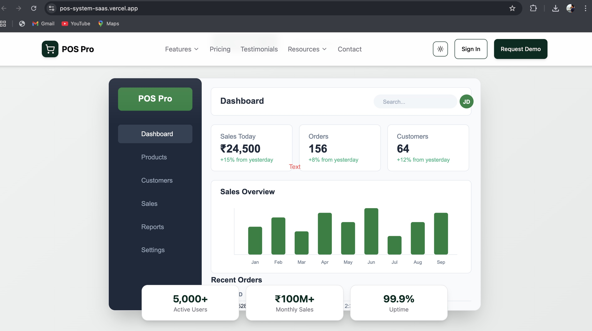
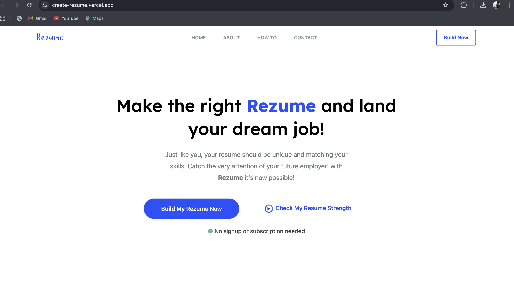
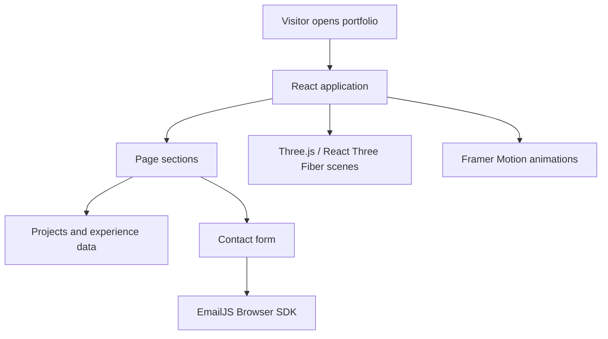

<div align="center">
  
  <h1>Shubham Kumar</h1>
  <h3>Full-Stack Developer · Java · Spring Boot · React</h3>
  <p>
    Building responsive web experiences, practical backend systems, and interactive interfaces.
  </p>
  <p>
    <a href="https://github.com/shubhamthakur9771"></a>
    <a href="https://www.linkedin.com/in/shubham-kumar-15695a217/"></a>
    <a href="https://leetcode.com/u/shubhamthakur9771/"></a>
  </p>
  <p>
    
    
    
    
    
  </p>
</div>

---

## ✨ About This Portfolio

Welcome to my developer portfolio! This is a responsive, single-page website designed to introduce my work, technical interests, and selected projects through a modern interface with interactive 3D elements.

The experience combines a React frontend with Three.js-powered scenes, motion effects, and a contact form integration.

<div align="center">
  <a href="https://github.com/shubhamthakur9771">Explore my GitHub</a>
  &nbsp;·&nbsp;
  <a href="https://www.linkedin.com/in/shubham-kumar-15695a217/">Connect on LinkedIn</a>
  &nbsp;·&nbsp;
  <a href="https://leetcode.com/u/shubhamthakur9771/">View LeetCode</a>
</div>

## 🧭 What's Inside

| Section | What you'll find |
|:--|:--|
| **Home** | Introduction with an interactive 3D desktop scene |
| **About** | Developer overview and areas of focus |
| **Experience** | Project-based experience and implementation highlights |
| **Technologies** | Visual showcase of tools and technologies |
| **Projects** | Selected applications and project summaries |
| **Contact** | Contact form and professional profile links |

## 🚀 Featured Work

<table>
  <tr>
    <td width="50%" valign="top">
      <a href="https://pos-system-saas.vercel.app/">
        
      </a>
      <h3>POS Management System · SaaS</h3>
      <p>A multi-store point-of-sale application built with Spring Boot, React, and MySQL. Includes REST APIs, JWT-based role access, inventory and billing workflows, and branch-oriented functionality.</p>
      <p><strong>Stack:</strong> Java · Spring Boot · React · MySQL · JWT</p>
      <a href="https://pos-system-saas.vercel.app/">Live application ↗</a>
    </td>
    <td width="50%" valign="top">
      <a href="https://create-rezume.vercel.app/">
        
      </a>
      <h3>Rezume · AI Resume Builder</h3>
      <p>A resume builder with React, Tailwind CSS, Context API, local persistence, PDF generation, and Gemini API-based resume analysis.</p>
      <p><strong>Stack:</strong> React · Tailwind CSS · Context API · Gemini API</p>
      <a href="https://create-rezume.vercel.app/">Live application ↗</a>
    </td>
  </tr>
</table>

### Employee Management System · JDBC

A Java backend learning project built with JDBC and MySQL. It demonstrates CRUD operations, prepared statements, connection/resource handling, search and filtering, and transaction-based bulk operations.

**Stack:** Core Java · JDBC · MySQL

> The portfolio source currently links this project to the GitHub profile rather than a dedicated repository. Update it when the exact public repository URL is available.

## 🛠️ Technology Stack

<div align="center">
  <h4>Frontend & UI</h4>
  
  <h4>3D, Animation & Design</h4>
  
  <h4>Backend & Data</h4>
  
  <h4>Development Tools</h4>
  
</div>

### Libraries used in this project

| Purpose | Libraries / Tools |
|:--|:--|
| UI | React 18, React Icons, React Toastify |
| Build | Vite 6 |
| Styling | Tailwind CSS, PostCSS, Autoprefixer |
| 3D rendering | Three.js, React Three Fiber, React Three Drei |
| Animation | Framer Motion, Maath, React Tilt |
| Contact form | EmailJS Browser SDK |
| Code quality | ESLint |

## 🧩 How It Works



## 💻 Run Locally

### Prerequisites

- Node.js 20 or later recommended
- npm
- EmailJS account (only if you want the contact form to send messages)

### 1. Clone the repository

```bash
git clone https://github.com/<your-github-username>/<your-repository-name>.git
cd <your-repository-name>
```

Replace the placeholders with your actual repository URL and directory name.

### 2. Install dependencies

```bash
npm install
```

### 3. Configure environment variables

Create a `.env` file in the project root:

```env
VITE_EMAILJS_SERVICE_ID=
VITE_EMAILJS_TEMPLATE_ID=
VITE_EMAILJS_PUBLIC_KEY=
```

You can copy the variable names from [`.env.example`](.env.example) and fill in the values from your EmailJS dashboard. The contact form uses the template variables `from_name`, `from_email`, and `message`.

### 4. Start the development server

```bash
npm run dev
```

Open the local URL printed by Vite (usually `http://localhost:5173`).

### 5. Build for production

```bash
npm run build
```

### 6. Preview the production build

```bash
npm run preview
```

## 📜 Available Commands

| Command | Description |
|:--|:--|
| `npm run dev` | Start the Vite development server |
| `npm run build` | Generate the production build in `dist/` |
| `npm run preview` | Preview the production build locally |
| `npm run lint` | Run ESLint checks |

## 📁 Project Structure

```text
portfolio/
├── public/
│   ├── desktop_pc/          # 3D desktop model, textures and attribution
│   ├── planet/              # 3D planet model, textures and attribution
│   └── logo.svg
├── src/
│   ├── assets/              # Images, icons, technology and project assets
│   ├── components/
│   │   ├── canvas/          # React Three Fiber scenes and 3D objects
│   │   ├── About.jsx
│   │   ├── Contact.jsx
│   │   ├── Experience.jsx
│   │   ├── Feedbacks.jsx
│   │   ├── Hero.jsx
│   │   ├── Navbar.jsx
│   │   ├── Tech.jsx
│   │   └── Works.jsx
│   ├── constants/            # Navigation, skills, experience and project data
│   ├── hoc/                  # Section wrapper components
│   ├── utils/                # Animation helpers
│   ├── App.jsx
│   ├── App.css
│   ├── index.css
│   ├── main.jsx
│   └── styles.js
├── .env.example
├── .gitignore
├── index.html
├── package.json
├── package-lock.json
├── tailwind.config.js
└── vite.config.js
```

## ☁️ Deployment

The project uses Vite and can be deployed to Vercel or another static hosting provider that supports Vite.

### Deploy with Vercel

1. Import the GitHub repository into Vercel.
2. Select **Vite** as the framework preset if it is not detected automatically.
3. Set the build command to `npm run build`.
4. Set the output directory to `dist`.
5. Add the three `VITE_EMAILJS_*` variables in the project's environment settings if the contact form is enabled.
6. Deploy the project.

## 🔐 Security Notes

- Keep `.env` files out of version control; `.gitignore` is configured for this.
- Vite embeds `VITE_*` variables in the client bundle. Treat them as public values.
- The EmailJS public key is designed for browser-side use; never expose a private key, SMTP password, or server-side credential in frontend code.
- Configure allowed domains and usage limits in the EmailJS dashboard.
- Review the public contact details in the Contact section before publishing.

For the repository's source-file review, see [`SECURITY-REVIEW.md`](SECURITY-REVIEW.md).

## 🎨 3D Model Credits

This project includes third-party 3D models. Please retain the attribution and license files when redistributing or deploying the models.

- **Stylized planet** by cmzw — [CC BY 4.0](https://creativecommons.org/licenses/by/4.0/). See [`public/planet/license.txt`](public/planet/license.txt).
- **Gaming Desktop PC** by Yolala1232 — [CC BY 4.0](https://creativecommons.org/licenses/by/4.0/). See [`public/desktop_pc/license.txt`](public/desktop_pc/license.txt).

## 🤝 Connect

<div align="center">
  <a href="https://github.com/shubhamthakur9771"></a>
  <a href="https://www.linkedin.com/in/shubham-kumar-15695a217/"></a>
  <a href="https://leetcode.com/u/shubhamthakur9771/"></a>
</div>

---

<div align="center">
  <sub>Designed and developed with React, Vite, and Three.js · Shubham Kumar</sub>
</div>
